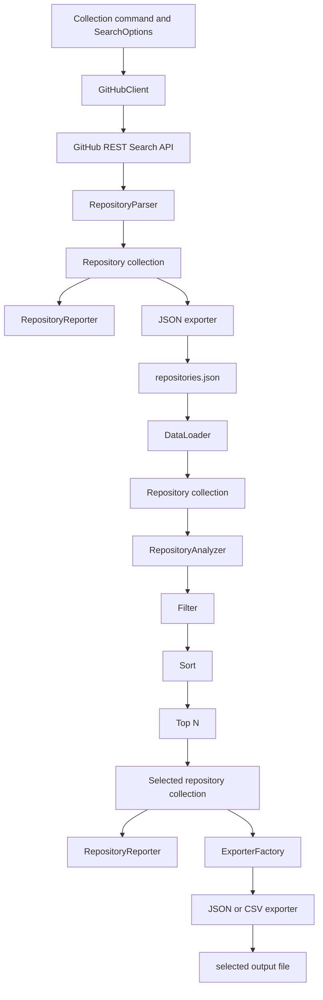
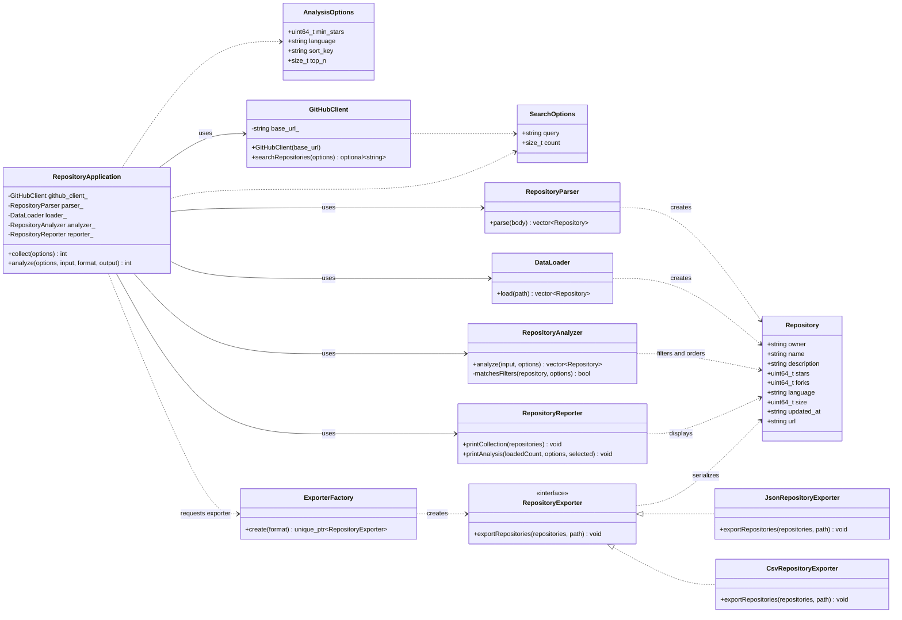
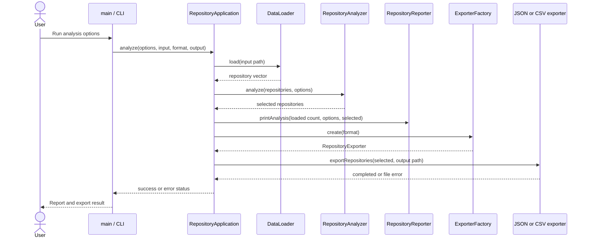

# CS3460 Project - GitHub Crawler

## System Design for Refactoring

**Project:** CS3460 GitHub Crawler  
**Design status:** Proposed design for the final refactoring milestone

## Overview

This document describes the requirements, proposed object-oriented design, and planned tests for the GitHub Crawler. The system has two workflows. The collection workflow searches the GitHub REST API, converts the response into `Repository` values, displays the collected metadata, and saves a local dataset. The analysis workflow reads that saved dataset without making another GitHub request, filters and sorts the repository values, selects the top N results, displays them, and exports the same selected collection as JSON or CSV.

The design builds on the working implementation thus far. The final refactoring implemented later will preserve the existing `Repository` data model and the two workflows while making responsibilities more explicit. In particular, the current local-loading function will become a `DataLoader` class, and the current `RepositoryStore` responsibilities will be separated into reporting and export classes.

## 1. Requirements Analysis

The requirements below describe observable behavior that can be verified with component and integration tests.

| ID | Requirement |
|---|---|
| **R1 - Repository collection** | The system shall accept a configurable GitHub repository search query and request between 1 and 100 public repositories from the GitHub REST Search API. A GitHub token may be supplied through the `GITHUB_TOKEN` environment variable; the program shall not require a token for public searches. |
| **R2 - API response parsing** | The system shall convert each returned repository item into the shared `Repository` value type, including owner, name, description, stars, forks, language, size, update time, and HTML URL. Null description and language values shall be represented as empty strings. |
| **R3 - Collection output and persistence** | During collection, the system shall display the required metadata for each returned repository and save the collected `Repository` values as a valid JSON array in `repositories.json`. |
| **R4 - Local dataset loading** | The analysis workflow shall load the existing `repositories.json` file into `std::vector<Repository>` without sending a request to GitHub. A missing, malformed, non-array, or structurally invalid dataset shall produce a clear error. |
| **R5 - Repository filtering** | The analyzer shall support a minimum-star filter and an optional exact-match programming-language filter. An empty language option shall allow repositories in any language. |
| **R6 - Repository sorting** | The analyzer shall sort the filtered values in descending order by stars, forks, or update time. Equal primary sort values shall be ordered deterministically by owner and then repository name. |
| **R7 - Top-N selection** | The analyzer shall apply the top-N limit after filtering and sorting. It shall return exactly N values when at least N values match, or all matching values when fewer than N match. A top-N value of zero shall return an empty selection. |
| **R8 - Analysis reporting and export** | The system shall display the selected repositories and export exactly that same selected collection to JSON or CSV. Each export shall contain all nine `Repository` metadata fields. CSV values containing commas, quotes, or line breaks shall be escaped correctly. |
| **R9 - Command-line configuration and errors** | The command-line interface shall expose collection and analysis options, reject unsupported sort keys or export formats, and report invalid arguments or file/request failures without silently producing an incorrect result. |

### Workflow summary

The collection and analysis workflows are intentionally separate. Milestone 1 creates or refreshes the local dataset; Milestone 2 and the final implementation analyze that dataset locally.



## 2. System Design

### 2.1 Design approach

The proposed design follows separation of concerns and encapsulation. Network communication, API parsing, local file loading, analysis, console reporting, and file export are separate responsibilities. `main()` will handle command-line arguments and delegate the requested operation to a `RepositoryApplication` coordinator. It will not contain HTTP requests, JSON field extraction, filtering loops, sorting logic, or CSV formatting.

The existing `Repository` struct remains the single representation of repository metadata across both workflows. `SearchOptions` and `AnalysisOptions` remain small value types that carry configuration rather than behavior. This avoids duplicate repository models and keeps the JSON dataset produced by collection compatible with the local analysis workflow.

### 2.2 Major classes and responsibilities

| Class / type | Responsibility and important data | Main interface |
|---|---|---|
| **`Repository`** | Shared value type for one repository: `owner`, `name`, `description`, `stars`, `forks`, `language`, `size`, `updated_at`, and `url`. It is used by collection, loading, analysis, reporting, and export. | Data members; no service behavior. |
| **`SearchOptions`** | Carries the GitHub search query and requested count (default 100). | `query`, `count`. |
| **`AnalysisOptions`** | Carries local analysis settings: minimum stars, optional language, sort key, and top-N limit. | `min_stars`, `language`, `sort_key`, `top_n`. |
| **`GitHubClient`** | Owns responsibility for making the HTTPS request to GitHub. Builds the search path and headers, optionally reads `GITHUB_TOKEN`, checks the HTTP result, and returns the response body. Its API base URL will be configurable (defaulting to `https://api.github.com`) so tests can direct requests to a local test server. | `searchRepositories(const SearchOptions&)`; constructor accepts an optional base URL. |
| **`RepositoryParser`** | Converts GitHub's API response JSON into `std::vector<Repository>`. Handles nullable description and language fields and reports invalid response structures. | `parse(const std::string&)`. |
| **`DataLoader`** | Reads the M1 local dataset from a filesystem path, verifies that the top-level JSON value is an array, and reconstructs `Repository` values. It does not use `GitHubClient`. | `load(const std::filesystem::path&)`. |
| **`RepositoryAnalyzer`** | Applies filters, sorts using named comparison functions, and truncates the sorted result to top N. It does not print or write files. | `analyze(const std::vector<Repository>&, const AnalysisOptions&)`. |
| **`RepositoryReporter`** | Produces human-readable collection details and an analysis summary/table on standard output. It does not change repository data or write export files. | `printCollection(...)`, `printAnalysis(...)`. |
| **`RepositoryExporter`** | Abstract interface for writing a selected repository collection to a file. | `exportRepositories(const std::vector<Repository>&, const std::filesystem::path&)`. |
| **`JsonRepositoryExporter`** | Serializes the supplied repository values as a JSON array using nlohmann/json. | Implements `exportRepositories(...)`. |
| **`CsvRepositoryExporter`** | Writes the same repository fields as CSV and correctly escapes special field contents. | Implements `exportRepositories(...)`. |
| **`ExporterFactory`** | Creates the exporter corresponding to the requested format (`json` or `csv`). Keeps format selection out of the analysis and reporting logic. | `create(const std::string&)`. |
| **`RepositoryApplication`** | Coordinates the collection and analysis use cases. It invokes the service classes in the required order and passes the selected vector unchanged to reporting and export. | `collect(const SearchOptions&)`, `analyze(const AnalysisOptions&, ...)`. |

`RepositoryApplication` coordinates the workflow but does not implement the details of HTTP, JSON parsing, sorting, or output formatting. The individual services can therefore be tested independently.

### 2.3 Class relationships

The diagram shows the proposed dependencies. `RepositoryApplication` uses the service classes to coordinate a workflow. `JsonRepositoryExporter` and `CsvRepositoryExporter` implement the common `RepositoryExporter` interface. The `ExporterFactory` creates one of those concrete implementations based on the requested format. `Repository` is a shared value type passed between components; it is not owned exclusively by any one service.



### 2.4 Representative C++ interfaces

The following declarations illustrate the important boundaries. They are representative design interfaces; the final refactoring may adjust parameter names or const qualifications while preserving the responsibilities described above.

**Shared model and options**

```cpp
struct Repository {
    std::string owner;
    std::string name;
    std::string description;
    std::uint64_t stars{};
    std::uint64_t forks{};
    std::string language;
    std::uint64_t size{};
    std::string updated_at;
    std::string url;
};

struct SearchOptions {
    std::string query;
    std::size_t count{100};
};

struct AnalysisOptions {
    std::uint64_t min_stars{};
    std::string language;
    std::string sort_key{"stars"};
    std::size_t top_n{10};
};
```

**GitHub request and API parsing**

```cpp
class GitHubClient {
private:
    std::string base_url_;

public:
    explicit GitHubClient(
        std::string base_url = "https://api.github.com");

    std::optional<std::string> searchRepositories(
        const SearchOptions& options) const;
};

class RepositoryParser {
public:
    std::vector<Repository> parse(
        const std::string& response_body) const;
};
```

The configurable base URL defaults to GitHub in normal operation. A test can provide a local HTTP test server instead, allowing request success and failure behavior to be checked without relying on external network access.

**Local loading and analysis**

```cpp
class DataLoader {
public:
    std::vector<Repository> load(
        const std::filesystem::path& path) const;
};

class RepositoryAnalyzer {
public:
    std::vector<Repository> analyze(
        const std::vector<Repository>& input,
        const AnalysisOptions& options) const;
};
```

The analyzer will retain named comparator functions for stars, forks, and update time. It will apply operations in the required order: filter, sort, then top-N selection. Owner and repository name will provide deterministic tie-breaking.

**Exporter interface and factory**

```cpp
class RepositoryExporter {
public:
    virtual void exportRepositories(
        const std::vector<Repository>& repositories,
        const std::filesystem::path& path) const = 0;

    virtual ~RepositoryExporter() = default;
};

class JsonRepositoryExporter final : public RepositoryExporter {
public:
    void exportRepositories(
        const std::vector<Repository>& repositories,
        const std::filesystem::path& path) const override;
};

class CsvRepositoryExporter final : public RepositoryExporter {
public:
    void exportRepositories(
        const std::vector<Repository>& repositories,
        const std::filesystem::path& path) const override;
};

class ExporterFactory {
public:
    static std::unique_ptr<RepositoryExporter> create(
        const std::string& format);
};
```

The factory returns a polymorphic exporter. The calling code only needs the `RepositoryExporter` interface and does not need to know which concrete exporter was constructed.

### 2.5 Class interactions

**Collection workflow (R1-R3).** The command-line layer parses the collection command into `SearchOptions` and calls `RepositoryApplication::collect()`. The application asks `GitHubClient` for the API response. If the request succeeds, `RepositoryParser` converts the response into `Repository` values. `RepositoryReporter` displays the collection details, and the JSON exporter writes those values to `repositories.json`. A request or parse error is reported and prevents an incomplete dataset from being treated as a successful collection.

**Local analysis workflow (R4-R8).** The command-line layer creates `AnalysisOptions` and supplies the input path, output format, and output path to `RepositoryApplication::analyze()`. The application asks `DataLoader` to read the local dataset. It passes the resulting vector to `RepositoryAnalyzer`, which filters, sorts, and applies top N. The application then passes the same selected vector to `RepositoryReporter` and to the exporter returned by `ExporterFactory`. The exporter does not reload the original dataset or repeat the analysis. This ensures the terminal report and output file represent exactly the same selection.



### 2.6 Optional design pattern: Factory

The proposed refactoring uses the **Factory pattern** for output-format selection. In the current implementation, the store contains separate JSON and CSV operations, and the command-line workflow chooses which method to call. This is manageable for two formats, but format selection and serialization are coupled to the same store class.

`ExporterFactory` will centralize the decision to create a `JsonRepositoryExporter` or `CsvRepositoryExporter`. Both concrete exporters implement `RepositoryExporter`, so `RepositoryApplication` uses the same interface regardless of format. Adding another export format later would require a new exporter and a factory case, without changing filtering, sorting, top-N selection, or reporting.

The pattern is useful here because JSON and CSV are alternative implementations of one output responsibility. It is not being added merely as a label: it removes format-specific branching from the application workflow and gives each exporter one focused responsibility. The final milestone will implement and test the factory and both concrete exporters.

## 3. Test Design

The planned tests verify observable behavior at the component and workflow levels. Tests will use small, known JSON fixtures and temporary output files so most cases do not depend on network access or the live GitHub service. The tests are designs only; actual results and pass/fail status will be recorded after implementation in the final milestone.

### 3.1 Planned test cases

| Test | Target | Input / setup | Expected result |
|---|---|---|---|
| **T1 - Search option validation (R1)** | `GitHubClient` | Try counts of 1, 100, 0, and 101. | Counts 1 and 100 are accepted; 0 and 101 are rejected with a clear error. |
| **T2 - API response parsing (R2)** | `RepositoryParser` | Parse a fixture response containing two repository items with all metadata fields. | Two `Repository` values are produced with each field mapped to the correct value. |
| **T3 - Nullable API fields (R2)** | `RepositoryParser` | Parse an item whose `description` and `language` fields are JSON null. | Both corresponding C++ strings are empty; parsing succeeds. |
| **T4 - Invalid API response (R2)** | `RepositoryParser` | Supply malformed JSON or a valid JSON object without an `items` array. | Parsing fails with a clear error; no partial collection is saved. |
| **T5 - Collection persistence (R3)** | Collection application / JSON exporter | Provide a known vector of repositories and write it to a temporary JSON file. | The file is a valid JSON array containing the nine expected fields and the same repository values. |
| **T6 - Load valid dataset (R4)** | `DataLoader` | Load a fixture containing two valid repository objects. | Two `Repository` values are returned and their fields match the fixture. |
| **T7 - Invalid dataset files (R4)** | `DataLoader` | Try a nonexistent file, malformed JSON, a top-level object instead of an array, and an object missing a required field. | Each invalid input produces a clear error; no invalid repository collection is returned. |
| **T8 - Minimum-star boundary (R5)** | `RepositoryAnalyzer` | Use repositories with 999, 1000, and 1001 stars; set `min_stars` to 1000. | The 1000- and 1001-star repositories remain; the 999-star repository is excluded. |
| **T9 - Language filter (R5)** | `RepositoryAnalyzer` | Use repositories with languages `C++`, `Python`, and empty language; test `language = "C++"` and then an empty language option. | The exact `C++` run returns only C++ repositories; the empty option permits all languages. |
| **T10 - Stars, forks, and update sorting (R6)** | `RepositoryAnalyzer` | Use a fixture with deliberately different star counts, fork counts, and ISO-formatted update times. Run each sort key. | Each mode returns descending values for its selected field. |
| **T11 - Deterministic sort ties (R6)** | `RepositoryAnalyzer` | Give multiple repositories the same primary sort value but different owners and names; repeat the analysis. | Tied repositories are ordered by owner and then name, and repeated runs produce the same order. |
| **T12 - Top-N boundaries (R7)** | `RepositoryAnalyzer` | Test top N values of 3, 10, and 0 against a filtered collection of five repositories. | N=3 returns three; N=10 returns all five; N=0 returns an empty vector. |
| **T13 - No filter matches (R5, R7)** | `RepositoryAnalyzer` | Set a minimum-star threshold or language that matches no fixture repository. | The selected vector is empty; reporting states that no repositories matched; export contains an empty collection (plus a CSV header when applicable). |
| **T14 - Reporter output (R8)** | `RepositoryReporter` | Pass a known selected vector and capture standard output. | The report contains the expected table headings, selected repository names, stars, forks, languages, and update times; it reports the selected count. |
| **T15 - JSON exporter consistency (R8)** | `JsonRepositoryExporter` | Export a known selected vector, parse the output file, and compare its objects with the supplied vector. | The output is a valid JSON array containing exactly the selected repositories and all nine fields. |
| **T16 - CSV escaping and fields (R8)** | `CsvRepositoryExporter` | Export repositories whose descriptions contain commas, quotes, and line breaks. | The CSV is parseable; special values are escaped correctly and every data row contains the nine fields. |
| **T17 - Exporter factory (R8, Factory)** | `ExporterFactory` | Request `json`, `csv`, and an unsupported format. | The factory creates the corresponding concrete exporter for JSON and CSV; an unsupported format produces a clear error. |
| **T18 - End-to-end local analysis (R4-R9)** | `RepositoryApplication` | Supply a temporary M1-style dataset, minimum-star and language filters, a sort key, top N, and a selected export format. | The application loads locally, selects the expected rows, reports them, and exports exactly the same rows. The analysis path does not invoke `GitHubClient`. |
| **T19 - Command-line validation (R9)** | CLI / application | Provide a missing option value, invalid number, unsupported sort key, and unsupported format. | Each invalid invocation exits unsuccessfully and prints a useful error instead of silently using an unintended setting. |
| **T20 - Collection request failure (R1, R3)** | `GitHubClient` / collection application | Configure `GitHubClient` to use a local test HTTP server that returns a non-200 response, or make the test server unavailable. | The failure is reported; collection stops and does not claim a successful new dataset was saved. |

### 3.2 Coverage and evaluation plan

| Requirement | Supporting tests | Evidence to record in the final milestone |
|---|---|---|
| **R1 - Repository collection** | T1, T20 | Accepted count boundaries, request outcome, and clear handling of request failure. |
| **R2 - API response parsing** | T2-T4 | Correct field mapping, null handling, and rejection of invalid API responses. |
| **R3 - Collection output and persistence** | T5, T20 | Collection details and a valid saved JSON array with the expected records. |
| **R4 - Local dataset loading** | T6, T7, T18 | Loaded record count, reconstructed values, and errors for invalid files. |
| **R5 - Repository filtering** | T8, T9, T13, T18 | Every selected record meets the requested star and language filters. |
| **R6 - Repository sorting** | T10, T11, T18 | Descending order for each sort key and deterministic ties. |
| **R7 - Top-N selection** | T12, T13, T18 | Correct result count for zero, fewer-than-N, and at-least-N cases. |
| **R8 - Reporting and export** | T14-T18 | Reported rows and exported JSON/CSV records are identical; CSV escaping is valid. |
| **R9 - Command-line configuration and errors** | T1, T17-T20 | Supported options work, invalid options fail clearly, and collection and analysis modes remain separate. |

The component tests use controlled fixtures to make expected values deterministic. The end-to-end analysis test uses a temporary local dataset, so it can verify loading, filtering, sorting, reporting, factory selection, and export without GitHub availability or rate limits. For collection request tests, the configurable API base URL lets a local test HTTP server provide controlled success and failure responses without contacting GitHub. For the final milestone, each test will record its actual result and pass/fail status, with any failure linked to the component responsible for that behavior.

## Conclusion

This design retains the working collection and local-analysis behavior while making the responsibilities more cohesive. `Repository` remains the shared model, `RepositoryAnalyzer` remains independent of I/O, and reporting is separated from serialization. The Factory-based exporter design provides a common output interface for JSON and CSV. The planned tests cover normal cases, boundary values, malformed inputs, file errors, deterministic sorting, export consistency, and the complete local analysis workflow.
